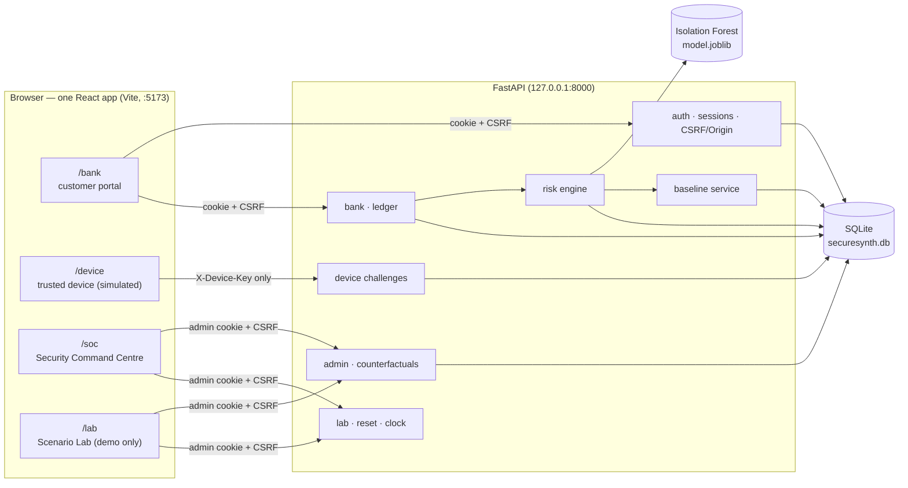

<p align="center"></p>

# SecureSynth

**Risk-based authentication and continuous account-takeover detection — a correct password and OTP are not proof that the customer is present.**

AVISHKAR'26 · 24-hour hackathon · Problem #24 *Risk-Based Authentication and Account Takeover Detection* · Domain: AI in Cyber Security and FinTech
Team **The_Terminators** · Team ID **AV26-50F33FD4DE**

> ⚠️ **Prototype on synthetic data only.**
> - Every customer, account, balance, device, location and attack in this repository is fictional (account refs start with `SYN-`).
> - No real money, real personal data or real bank systems are involved.
> - SecureSynth is not production-ready and makes no regulatory, compliance or bank-partnership claims.

---

## The problem
Attackers bypass passwords and one-time codes through phishing, real-time OTP relay and SIM swaps. Once inside, the session looks "authenticated" to the bank. Static rules ("new device → challenge") catch some of this, but they punish genuine customers who travel or change phones.

## What SecureSynth does
| | |
|---|---|
| **Authenticates** | Password (Argon2id) + genuine TOTP with replay protection. |
| **Continuously assesses risk** | At login, payee add and every transfer: personalised behavioural deviations → shared Isolation Forest → transparent policy points → **ALLOW / STEP-UP / BLOCK**, enforced by the backend. |
| **Verifies independently** | Step-up goes to a separately enrolled trusted device (simulated) with number matching. Challenges are single-use, 120 s, and bound to the exact session, operation and payload. Repeating the TOTP never counts. |
| **Learns without being poisoned** | New behaviour enters a *candidate* profile. Only the attribute verified on the trusted device can be promoted, and only after clean sessions + 24 h. Verified travel becomes a 7-day window, not permanent trust. Blocked sessions void their contributions. Every change is versioned and can be rolled back. |
| **Explains** | Analysts see four separate panels: ML anomaly index (a rarity percentile, *not* a probability), observed deviations from baseline, exact policy points, and the decision. They also get a hypothetical counterfactual and a full audit trail. Customers only see calm, category-level messages. |
| **Proves it** | A Scenario Lab drives six scenarios through the real API, with deterministic reset. A pre-registered evaluation compares three approaches on a fresh, untouched synthetic population. |

## Measured results (synthetic; see [docs/EVALUATION.md](docs/EVALUATION.md))
**Setup:**
- Frozen model.
- Protocol pre-registered before results ([docs/EVALUATION_PROTOCOL.md](docs/EVALUATION_PROTOCOL.md)).
- Fresh population of 240 customers (seed 9091) scored once.
- 4,665 sessions, 367 account takeovers.

| | Password + TOTP | Static rules | **SecureSynth** |
|---|---|---|---|
| Recall (takeovers intervened) | 0.000 | 0.766 | **0.913** |
| Precision | 0.000 | 0.186 | **0.601** |
| F1 | 0.000 | 0.299 | **0.725** |
| Legitimate sessions restricted | 0% | 28.6% | **5.2%** |
| Travellers restricted | 0% | 98.6% | **16.7%** |
| New-device sessions restricted | 0% | 27.8% | **8.7%** |
| Attack value prevented (of ₹3.10 cr) | ₹0 | ₹2.98 cr | ₹2.96 cr |
| …of which stopped outright by BLOCK | ₹0 | ₹2.38 cr | **₹2.61 cr** |
| Legitimate value delayed | ₹0 | ₹2.89 cr | **₹57 lakh** |
| …of which blocked outright | ₹0 | ₹0.3 lakh | ₹25 lakh |
| Decision latency p95 (in-process) | – | – | 5.61 ms |

**Honest reading:**
- **Higher recall at about one-fifth of the customer friction.**
- **It does not prevent more total money than static rules**, which challenge nearly everyone.
- **It stops more attack money outright, but also blocks more legitimate money outright.**
- **Weakness:** session hijack on the customer's own familiar device (recall 0.59). See [limitations](#limitations).

## The product
| Screen | What it shows |
|---|---|
| `/` | Landing: the identity orb and a live status line for the risk engine |
| `/bank` | Customer portal: balance, statements, payees, transfers, and a full-screen step-up focus that shows the number to match |
| `/device` | Simulated trusted device: number-matching approval |
| `/soc/intelligence` | **Command Centre:** live sessions; a Digital Twin orb visualising the backend's signals; risk index on a bezel with the real step-up and block thresholds |
| `/soc`, `/soc/users`, `/soc/evaluation` | Investigation, baselines with rollback, and the frozen evaluation as an editorial data story |
| `/lab` | Scenario Lab: the six scenarios as an event sequence with real before and after balances |
| `/judge` | **Judge Mode:** full-screen live runs, revealed step by step (R runs, Esc exits) |
| `/brand` | The Synth Core logo: a glass hero with an SVG fallback |

Screenshots: [docs/screenshots/](docs/screenshots/).

## Architecture

Details, request flow and trust boundaries: [docs/ARCHITECTURE.md](docs/ARCHITECTURE.md) · Threat model: [docs/THREAT_MODEL.md](docs/THREAT_MODEL.md)

## Tech stack
- **Backend:** Python 3.12, FastAPI, SQLAlchemy 2, Pydantic 2, SQLite (WAL), PyOTP, argon2-cffi, cryptography (Fernet), scikit-learn, NumPy, pandas (offline data generation only), pytest.
- **Frontend:** React 19 + TypeScript, Vite, Tailwind CSS v4, TanStack Query, Recharts, Lucide; three.js + React Three Fiber for the lazy-loaded glass identity orb and the Synth Core logo; Motion for reduced-motion-aware interface motion; Apple's system font (SF Pro on Apple devices), nothing downloaded.
- **Runs fully offline** after install. No Docker, no external APIs, no paid services.

## Install and run
Prerequisites:
- macOS or Linux;
- Python 3.12 (`brew install python@3.12`);
- Node 20+ (tested with Node 24 on Mac 1 and Node 22 on Mac 2);
- `make`.

Do the one-time setup on a good network.
```bash
git clone https://github.com/mdhussain398/SecureSynth.git
```
```bash
cd SecureSynth && make setup
```
`make setup`:
- creates `.venv` and installs the pinned `backend/requirements.txt`;
- runs `npm ci`;
- generates local secrets in `backend/.env`;
- trains the model (deterministic, about 5 s);

  > **Do not run `make setup` or `make train` on a machine that already holds the frozen artifacts copied from another machine.** Training overwrites `model.joblib`. Use the manual steps in [docs/MAC2_HANDOFF.md](docs/MAC2_HANDOFF.md) §12 instead.
- builds the demo database and a reset snapshot.

Run (two terminals):
```bash
make dev-backend
```
```bash
make dev-frontend
```
Open http://localhost:5173.
- **Demo accounts:** synthetic credentials for this machine are written to `backend/artifacts/demo_credentials.json`, which is gitignored and never committed.
- **TOTP:** scan each `totp_uri` into any authenticator app.
- **Trusted device:** pair `/device` with the account's `trusted_device_key`.

| Command | Purpose |
|---|---|
| `make test` | Backend test suite (89 tests) |
| `make train` | Retrain + validation tuning + write the frozen manifest |
| `make eval` | Final held-out evaluation (refuses if frozen files changed) |
| `make seed` | Rebuild the demo DB and its reset snapshot (new demo credentials) |
| `cd frontend && npm run dev:mock` | UI with an in-browser mock backend (no credentials needed) |

## Documentation
| Document | Contents |
|---|---|
| [docs/report/PROJECT_REPORT.md](docs/report/PROJECT_REPORT.md) (+ `.docx`, `.pdf`) | Full technical report |
| [docs/ARCHITECTURE.md](docs/ARCHITECTURE.md) | Components, request flows, data model, session modes |
| [docs/API.md](docs/API.md) | API reference generated from OpenAPI (contract v1.2.0) |
| [docs/KNOWN_LIMITATIONS.md](docs/KNOWN_LIMITATIONS.md) | Every known limitation in one place |
| [docs/SUBMISSION_CHECKLIST.md](docs/SUBMISSION_CHECKLIST.md) | Pre-submission and on-the-day checklist |
| [docs/THREAT_MODEL.md](docs/THREAT_MODEL.md) | Assets, attackers, trust boundaries, controls, out-of-scope, residual risk |
| [docs/EVALUATION.md](docs/EVALUATION.md) · [docs/EVALUATION_PROTOCOL.md](docs/EVALUATION_PROTOCOL.md) | Methodology, frozen results, limitations |
| [docs/DEMO.md](docs/DEMO.md) | 10-minute demo script, offline checklist, troubleshooting |
| [docs/RESOURCES.md](docs/RESOURCES.md) | External libraries, fonts, licences, AI assistance |
| [docs/TEAM.md](docs/TEAM.md) | Team and contributions |
| [docs/api-contract.md](docs/api-contract.md) | API contract (frontend ↔ backend) |
| [docs/FRONTEND_HANDOFF.md](docs/FRONTEND_HANDOFF.md) · [docs/MAC2_HANDOFF.md](docs/MAC2_HANDOFF.md) | Frontend design system and cross-machine handoff |
| [docs/progress-log.md](docs/progress-log.md) | Hackathon build log with test evidence |

## Limitations
- **Synthetic data.** Customers, attacks and drift were authored by the team; real attacker behaviour is more varied. Metrics show the method works on this data, not real-world performance.
- **Familiar-device takeover.** When an attacker operates the customer's own recognised device, from the usual city, at usual hours, behavioural baselines have little to separate on (recall 0.59). This would need payee-risk / transaction-intent signals.
- **Simulated signals:**
  - location comes from a synthetic IP→city table;
  - the "trusted device" is a web page holding a separate credential;
  - device recognition is a random server-issued cookie (a behavioural signal, not proof of identity, and no fingerprinting).
- **Risk index** is a rarity percentile against legitimate validation events, not a calibrated fraud probability.
- **Prototype infrastructure:** in-memory rate limits, single-node SQLite, local-only TLS-less dev servers.
- **Ghost Banking** (an isolated sandbox for blocked sessions) is designed but **not implemented**, and is disabled pending mentor approval under rule-book §12.
