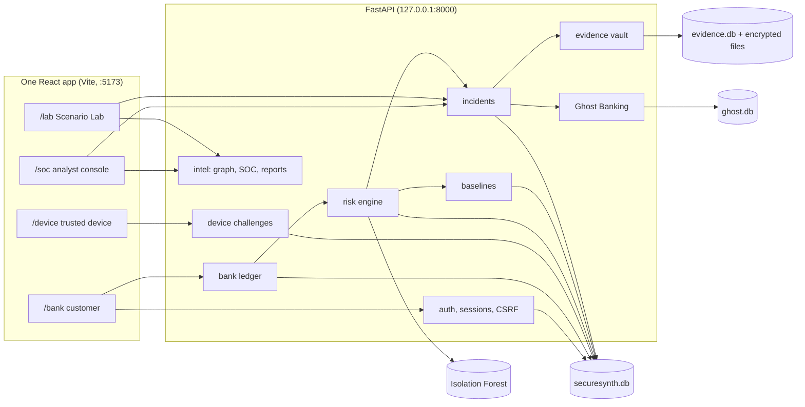

<p align="center"></p>

# SecureSynth

SecureSynth watches a banking session after the login succeeds. A correct password and a valid one-time code tell you someone has the credentials. They don't tell you the customer is the one at the keyboard, so SecureSynth keeps checking at login, when a payee is added and on every transfer, and asks for proof on a separate trusted device when the behaviour stops looking like that customer.

Built for AVISHKAR'26 (24-hour hackathon), problem #24: *Risk-Based Authentication and Account Takeover Detection*. Team The_Terminators (team ID AV26-50F33FD4DE): Mohammed Hussain, Ayman Ahmed, Samruddh HS and Syed Nihal Mudassir.

> **Synthetic data only.** Every customer, balance, device, location and attack in this repository is made up (account references start with `SYN-`). No real money, personal data or bank systems are involved, and this is a prototype, not a production system.


## Why we built it

Phishing kits relay one-time codes in real time, and SIM swaps hand attackers the SMS. After that the session looks perfectly authenticated to the bank. The usual fix is a set of static rules ("new device, so challenge"), which catches a lot of attacks but also challenges almost every customer who travels or buys a new phone. We wanted to see how far we could cut that friction without letting more attackers through, and to be honest about where it doesn't work.

## What happens to a risky session

1. **Sign-in.** Password (Argon2id) plus a real TOTP code with replay protection.
2. **Scoring.** At login, at payee creation and on every transfer, the backend compares the session with that customer's own baseline. A shared Isolation Forest turns the deviations into a rarity score, and a small set of written policy rules adds points on top. The result is ALLOW, STEP-UP or BLOCK, and the backend enforces it.
3. **Step-up.** The customer approves a number-matching prompt on a separately enrolled trusted device (simulated here). Each challenge is single use, expires after 120 seconds and is tied to the exact session, operation and payload. Typing the TOTP again never counts.
4. **Containment.** A blocked session is restricted. If Ghost Banking is switched on (it's off by default and needs mentor approval), the session is moved to an isolated synthetic bank instead, so the attacker keeps going while touching nothing real.
5. **Evidence.** Every restriction collects the server-observed network details, the registered device record, the risk assessment and the transfer attempt into an encrypted, hash-chained evidence vault. Tampering is detected and flagged, never silently repaired.
6. **Investigation.** Analysts get an incident queue, a per-incident workspace (evidence, timeline, summary), a correlation graph that links incidents through shared IPs, devices and payees, and a SOC dashboard. Correlations are presented as leads, not proof.
7. **Reporting and recovery.** An analyst can prepare a cybercrime complaint (demo destination by default; the official portal route is a guided hand-off, never an automatic submission) and restore a genuine customer through a fresh, verified sign-in.

The baseline learns carefully. New behaviour goes into a candidate profile and is only promoted after the customer verifies it on the trusted device and then has clean sessions for 24 hours. Verified travel becomes a 7-day window, not permanent trust. Blocked sessions lose their contributions, and every change is versioned so it can be rolled back.

## Results

We pre-registered the evaluation protocol, froze the model, then scored a fresh synthetic population once: 240 customers (seed 9091), 4,665 sessions, 367 account takeovers. Full method in [docs/evaluation/EVALUATION.md](docs/evaluation/EVALUATION.md).

| | Password + TOTP | Static rules | SecureSynth |
|---|---|---|---|
| Takeovers flagged (recall) | 0% | 76.6% | **91.3%** |
| Precision | 0% | 18.6% | **60.1%** |
| Genuine sessions interrupted | 0% | 28.6% | **5.2%** |
| Travellers interrupted | 0% | 98.6% | **16.7%** |
| New-device sessions interrupted | 0% | 27.8% | **8.7%** |
| Attack money prevented (of ₹3.10 cr) | ₹0 | ₹2.98 cr | ₹2.96 cr |
| ...stopped outright by BLOCK | ₹0 | ₹2.38 cr | **₹2.61 cr** |
| Genuine money delayed | ₹0 | ₹2.89 cr | **₹57 lakh** |
| ...blocked outright | ₹0 | ₹0.3 lakh | ₹25 lakh |
| Decision latency, p95 (in process) | | | 5.61 ms |

What we take from it: SecureSynth catches more takeovers than static rules while interrupting about a fifth as many genuine customers. It does not prevent more money in total, because static rules challenge nearly everyone and so stop almost as much. It blocks more attack money outright, and it also blocks more genuine money outright, which is a real cost. Its weak spot is an attacker using the customer's own recognised device from the usual city at the usual hour: recall there is 0.59.

## Screens

| Page | What you see |
|---|---|
| [Landing](docs/screenshots/app/public-01-landing.jpg) `/` | The identity orb and live engine status |
| Customer bank `/bank` | Balance, statements, payees, transfers, and the full-screen step-up prompt |
| Trusted device `/device` | The simulated phone that approves number-matching challenges |
| [Intelligence](docs/screenshots/app/console-01-intelligence.jpg) `/soc/intelligence` | Live sessions and the risk index against the real thresholds |
| [SOC dashboard](docs/screenshots/app/console-02-soc-dashboard.jpg) `/soc/dashboard` | Metrics, Ghost Banking control and the live incident feed |
| [Sessions](docs/screenshots/app/console-03-sessions.jpg) `/soc` | Every session with its latest decision |
| [Incidents](docs/screenshots/app/console-04-incidents.jpg) `/soc/incidents` | The queue of restricted customers and the analyst decisions |
| [Fraud intel](docs/screenshots/app/console-05-fraud-intel.jpg) `/soc/intel` | The correlation graph between incidents |
| [Investigation](docs/screenshots/app/console-06-investigation.jpg) `/soc/investigations/:id` | Evidence, timeline, summary and report for one incident |
| [Reports](docs/screenshots/app/console-09-reports.jpg) `/soc/reports` | Prepared cybercrime complaints and their status |
| [Evaluation](docs/screenshots/app/console-10-evaluation.jpg) `/soc/evaluation` | The frozen evaluation, written up as a data story |
| [Scenario Lab](docs/screenshots/app/console-11-scenario-lab.jpg) `/lab` | 11 scripted attacks and genuine customers run through the real API |
| [Judge mode](docs/screenshots/app/public-02-judge-mode.jpg) `/judge` | Full-screen live runs, revealed one step at a time |

All current screenshots are in [docs/screenshots/app](docs/screenshots/app).

## Architecture



The protected bank, Ghost Banking, the evidence vault and the demo complaint service each use their own SQLite file, and the backend refuses to start if two of them point at the same database. More in [docs/architecture](docs/architecture).

## Repository layout

```text
SecureSynth/
├── backend/                 FastAPI service
│   ├── app/
│   │   ├── routers/         HTTP endpoints (auth, bank, device, admin, investigation, lab)
│   │   ├── risk/            features, Isolation Forest wrapper, policy rules, decision engine
│   │   ├── services/        sessions, challenges, baselines, ledger, incidents, enforcement
│   │   ├── security/        passwords, TOTP, tokens, rate limits, secret storage
│   │   ├── evidence/        evidence collection and the hash-chained vault
│   │   ├── ghost/           Ghost Banking (isolated synthetic bank)
│   │   ├── intel/           correlation graph, SOC metrics, summaries, reports, PDF
│   │   ├── dummy_ccr/       local demo complaint service (never contacts anything real)
│   │   └── lab/             Scenario Lab scenarios
│   ├── ml/                  synthetic data generation, training, held-out evaluation
│   └── tests/               pytest suite (165 tests)
├── frontend/                React 19 + TypeScript + Vite
│   └── src/
│       ├── features/        bank, device, soc, investigation, lab pages
│       ├── renaissance/     landing, Intelligence, Judge mode, the 3D orb
│       ├── design/          design tokens and shared components
│       ├── api/             typed API client and TanStack Query hooks
│       └── layout/          app shells and navigation
├── docs/                    everything written about the project (index: docs/README.md)
├── Makefile                 setup, run, test, train, evaluate
└── .env.example             the environment variables the backend reads
```

## Running it locally

You need macOS or Linux, Python 3.12, Node 20 or newer, and `make`. Do the first setup on a decent network; after that it runs fully offline, with no Docker and no external APIs.

```bash
git clone https://github.com/mdhussain398/SecureSynth.git
```

```bash
cd SecureSynth && make setup
```

`make setup` creates `.venv`, installs the pinned backend requirements, runs `npm ci`, writes fresh local secrets to `backend/.env`, trains the model (about 5 seconds, deterministic) and builds the demo database with a reset snapshot.

> If you copied frozen model artifacts from another machine, don't run `make setup` or `make train`: training overwrites `model.joblib`. Follow the manual steps in [docs/handoffs/MAC2_HANDOFF.md](docs/handoffs/MAC2_HANDOFF.md) §12.

Then start the two servers, each in its own terminal:

```bash
make dev-backend
```

```bash
make dev-frontend
```

Open http://localhost:5173. Demo credentials for your machine are written to `backend/artifacts/demo_credentials.json`, which is gitignored. Scan each `totp_uri` into an authenticator app, and pair `/device` with the account's `trusted_device_key`.

| Command | What it does |
|---|---|
| `make test` | Run the backend tests |
| `make train` | Retrain, tune on the validation window and write the frozen manifest |
| `make eval` | Run the held-out evaluation (refuses if the frozen files changed) |
| `make seed` | Rebuild the demo database and its reset snapshot, with new credentials |
| `cd frontend && npm run dev:mock` | Run the UI against an in-browser mock backend |

## Documentation

Start at [docs/README.md](docs/README.md). The most useful pieces:

- [Project report](docs/report/PROJECT_REPORT.md), also as `.docx` and `.pdf`
- [Presentation deck](docs/presentation/SecureSynth_Deck.pptx) and its [speaker notes](docs/presentation/SPEAKER_NOTES.md)
- [Architecture](docs/architecture/ARCHITECTURE.md) and [threat model](docs/architecture/THREAT_MODEL.md)
- [Evaluation](docs/evaluation/EVALUATION.md) and [known limitations](docs/evaluation/KNOWN_LIMITATIONS.md)
- [Demo script](docs/guides/DEMO.md)

## Limitations

- The data is synthetic and the team wrote the attacks, so real attackers will be more varied. The numbers show the method works on this data, not how it would perform in a bank.
- Familiar-device takeover is the gap. When the attacker uses the customer's own device from their usual place and time, there's little in the behaviour to separate on. Payee risk and transaction intent signals would be the next thing to add.
- Location comes from a synthetic IP-to-city table, the trusted device is a web page holding its own credential, and device recognition is a random server-issued cookie. There is no fingerprinting.
- The risk index is a rarity percentile against genuine validation sessions. It is not a fraud probability.
- Rate limits live in memory, the database is single-node SQLite, and the dev servers run without TLS.
- Ghost Banking deceives the session holder, so it ships switched off and needs mentor approval before it can be enabled.
