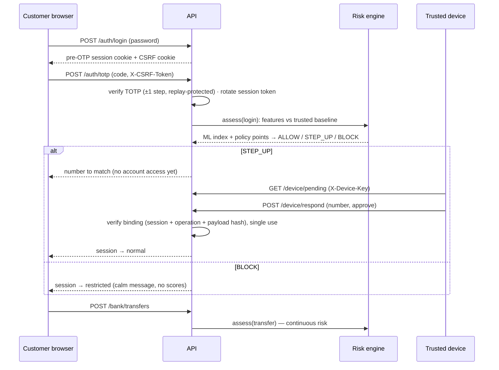

# SecureSynth architecture

## Components
| Layer | Location | Responsibility |
|---|---|---|
| Customer portal | `frontend/src/features/bank` | Login, TOTP, approval waiting, overview, statements, payees, transfers, restricted state |
| Trusted device (simulated) | `frontend/src/features/device` | Separate credential (`X-Device-Key`), number-matching approvals |
| Security Command Centre | `frontend/src/features/soc` | Live sessions, investigation, what-if, baselines, evaluation |
| Scenario Lab | `frontend/src/features/lab` | Six scripted scenarios through the real API, reset, simulated clock |
| Auth & sessions | `backend/app/routers/auth.py`, `services/sessions.py`, `security/*` | Argon2id, TOTP + replay guard, hashed rotating tokens, CSRF double-submit, Origin guard, expiry |
| Banking & ledger | `routers/bank.py`, `services/ledger.py` | Idempotent transfers, atomic conditional debit, payee ownership checks |
| Risk engine | `risk/features.py`, `risk/model.py`, `risk/policy.py`, `risk/engine.py` | Personalised features → Isolation Forest index → policy points → decision; explanations |
| Enforcement | `services/enforcement.py`, `services/challenges.py`, `routers/device.py` | Session modes, challenge binding, single-use approval executing the bound payload |
| Baseline learning | `services/baseline.py` | Trusted vs candidate profile, promotion rules, travel windows, rollback |
| Admin & lab | `routers/admin.py`, `routers/lab.py`, `lab/scenarios.py` | Investigation API, counterfactuals, demo-only lab |
| ML pipeline | `backend/ml/{generate,train,evaluate}.py` | Synthetic data, training, validation tuning, frozen final evaluation |

## Frontend architecture (Renaissance redesign)
| Part | Location | Notes |
|---|---|---|
| Design system | `frontend/src/design/tokens.css`, `renaissance/rn.css` | Porcelain, crystal, silver, electric blue and graphite. Amber and red are reserved for security states. |
| Glass identity orb | `renaissance/orb/` | R3F scene, lazy-loaded. Visualises **backend** signals (`assessment.features`, `deviations`, `decision`); it is not the model. CSS fallback without WebGL. |
| Command Centre | `renaissance/Intelligence.tsx` | Live sessions, Digital Twin orb, risk bezel with the real thresholds, signal inspector |
| Judge Mode | `renaissance/JudgeMode.tsx` | Calls the real Lab API and reveals the recorded steps one at a time |
| Scenario event sequence | `renaissance/RunSequence.tsx` | Authentication → behavioural assessment → risk evaluation → decision → outcome |
| Brand | `brand/` | Synth Core: SVG nav mark, R3F glass hero (`/brand`), static exports in `public/brand/` |

Route guards in the frontend are for UX only; the backend enforces every permission.

## Request flow: login → OTP → risk → decision


## Scoring
```
features  = personalised deviations of this event from the customer's trusted baseline
            (only events before the assessment time are used)
ml_index  = percentile of the Isolation Forest anomaly score among legitimate validation events (0–100)
score     = clip(W_ml · ml_index + Σ policy points, 0, 100)
decision  = BLOCK  if hard rule (impossible travel + unrecognised browser + sensitive action) or score ≥ t_block
            STEP_UP if score ≥ t_step, else ALLOW
```
The frozen values W_ml = 0.8, t_step = 77.73 and t_block = 89.1 were chosen on validation data only.

**Policy points** (exact, additive):
| Rule | Points |
|---|---|
| Unrecognised browser | +12 |
| Unfamiliar location | +8 |
| Impossible travel | +30 |
| Payee added < 10 min before transfer | +20 |
| Amount far above usual | +15 |
| ≥ 2 failed sign-ins | +8 |
| Verified travel window | −15 |

## Session modes
| Mode | Reads | Payee / transfer | Entered by |
|---|---|---|---|
| `pre_otp` | – | – | correct password |
| `normal` | ✓ | ✓ (risk-checked) | TOTP + ALLOW, or approved step-up |
| `step_up` | ✓ only if the step-up is for a later payment; ✗ while the login itself is unverified | ✗ | STEP_UP decision |
| `restricted` | ✗ | ✗ | BLOCK, denied or expired challenge |
| `revoked` | ✗ | ✗ | logout, expiry, analyst revoke, lab reset |

## Data model (SQLite)
- **Identity & sessions:** `users` (Argon2 hash, Fernet-encrypted TOTP seed, last TOTP step, trusted-device key hash), `devices` (recognition signal), `sessions` (hashed token + CSRF hash, mode, context).
- **Banking:** `accounts`, `beneficiaries`, `transactions` (status: attempted / pending_verification / restricted / completed; idempotency key).
- **Risk:** `risk_assessments` (features, deviations, ML raw/index, policy, decision, thresholds, latency), `challenges` (operation, payload hash, expiry, status).
- **Learning:** `baselines` (trusted + candidate JSON), `baseline_versions` (snapshot, diff, reason, rolled back).
- **Records:** `audit_events` (allow-listed fields only, never secrets), `history_events` (behavioural history).
- **Evaluation only:** `scenario_labels`. Inference code is test-enforced never to read it.

## Determinism & demo controls
- **Simulated clock** (`services/clock.py`) for all behavioural time. TOTP always uses real time, so authenticator apps work.
- **Lab reset** copies a pristine snapshot. It signs out everyone except the presenter's own admin session.
- **Lab context injection** (simulated city) is accepted only with an in-process lab token that never leaves the server.
