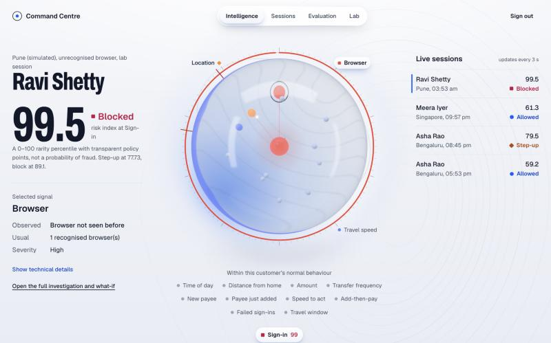
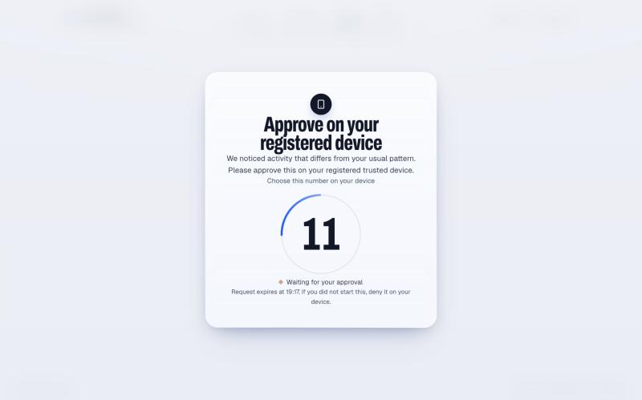
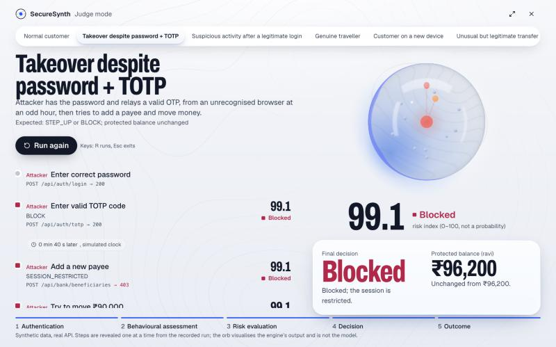
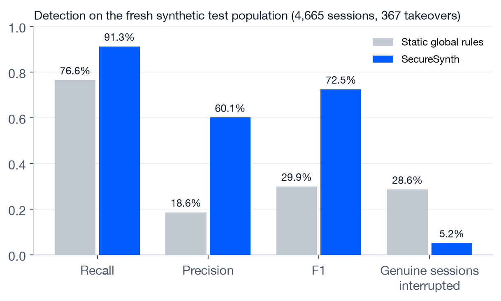
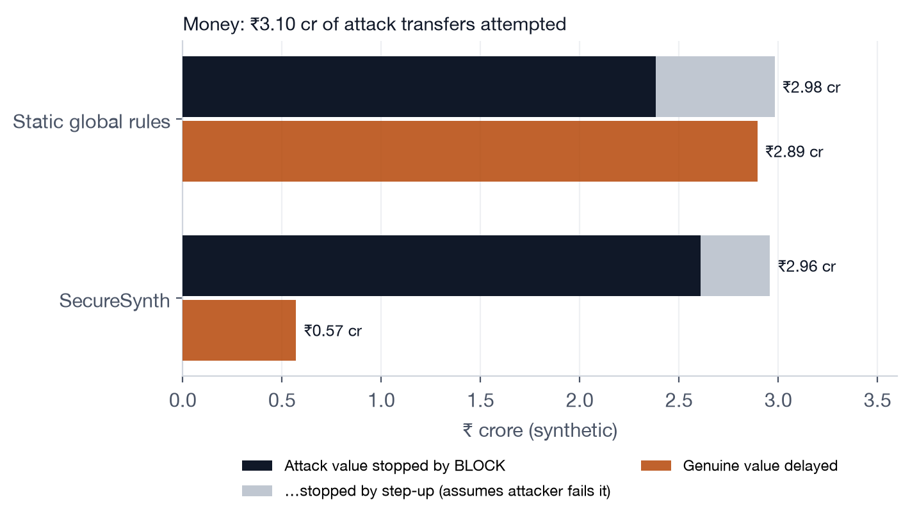

# SecureSynth: Risk-Based Authentication and Account Takeover Detection

**Technical report** · AVISHKAR'26 · Problem Statement 24 · Domain: AI in Cyber Security and FinTech

| | |
|---|---|
| Team | The_Terminators · Team ID AV26-50F33FD4DE |
| Members | Mohammed Hussain; members 2–4 **TBD** (to be completed by the team, see `docs/TEAM.md`) |
| Mentor / institution | **TBD** |
| Repository | https://github.com/mdhussain398/SecureSynth (branch `feat/frontend-renaissance`) |
| Model | Isolation Forest `iforest-v1-956f432a`, frozen; evaluation protocol v2 |
| Date | 25 November 2026 |

> **Scope and honesty statement.** SecureSynth is a working prototype on **synthetic data only**. Every customer, account, device, location and attack is fictional and authored by the team. The results below demonstrate the method on that data; **they are not real-world validation**. The risk index is a rarity percentile plus transparent policy points. **It is not a fraud probability.**

---

## 1. Summary
Attackers now routinely get past passwords and one-time codes through phishing, real-time OTP relay and SIM swaps. To the bank, a session opened that way looks authenticated. Static rules such as "new device → challenge" catch some of these attacks, but they punish genuine customers who travel or change phones.

SecureSynth treats authentication as a **continuous** decision.
- **Where it assesses:** at sign-in, when a payee is added and on every transfer.
- **How it assesses:** it compares the action with *this* customer's own trusted behaviour, scores the deviations with a shared Isolation Forest, adds transparent policy points, and returns **ALLOW**, **STEP-UP** or **BLOCK**.
- **Who enforces:** the backend enforces every decision.
- **Step-up:** goes to a separately enrolled trusted device with number matching.
- **Learning:** the system learns new behaviour only after independent verification, so an attacker cannot train it.

On a fresh synthetic test population scored once with a frozen model (4,665 sessions, 367 takeovers), SecureSynth compares with static global rules as follows:

| | Static rules | SecureSynth |
|---|---|---|
| Takeovers intervened (recall) | 76.6% | **91.3%** |
| Genuine sessions interrupted | 28.6% | **5.2%** |
| Precision | 18.6% | 60.1% |
| F1 | 29.9% | 72.5% |

Two results cut the other way:
- **It does not prevent more money overall.** Static rules prevent slightly more attack value (₹2.98 cr against ₹2.96 cr of ₹3.10 cr) by challenging almost everyone.
- **Its weakest case** is a hijack on the customer's own familiar device (recall 58.6%).

## 2. Problem understanding
### 2.1 Why password + TOTP is not enough
- **Phishing kits** relay the one-time code in real time.
- **SIM swaps** redirect SMS codes.
- **Session hijacking** takes over a session after a legitimate sign-in.

In each case the bank sees correct credentials. In our evaluation, password + TOTP alone intervened in **0 of 367** takeovers and let the full ₹3.10 cr of attempted attack transfers complete.

### 2.2 Why static rules are not the answer
Global rules judge every customer by the same yardstick. On the same population they intervened in 76.6% of takeovers, but they also interrupted:
- **28.6%** of all genuine sessions;
- **98.6%** of genuine travellers;
- **27.8%** of genuine new-device sessions.

Their precision was 18.6%: about four of every five interventions hit a genuine customer.

### 2.3 Stakeholders
| Stakeholder | Need |
|---|---|
| Customers | Not to lose money to a takeover; not to be blocked when they travel or change phone |
| Fraud and security analysts | Decisions they can explain, investigate and override |
| The bank | Lower fraud loss *and* lower friction, with an audit trail |

### 2.4 Success criteria (fixed before results; see `EVALUATION_PROTOCOL.md`)
- Higher takeover recall than static rules.
- Much lower interruption of genuine customers.
- Validation targets: intervention FPR ≤ 5%; block FPR ≤ 0.5%.
- Every decision explainable and enforced by the backend.
- A model frozen before a single scoring of a fresh test population.

## 3. Approach and innovation
### 3.1 Four-stage workflow
1. **Authenticate.** Password (Argon2id) and a genuine TOTP with replay protection. The session token rotates after TOTP.
2. **Assess.** At login, payee add and every transfer:
   - compute 15 behavioural deviations against the customer's trusted baseline;
   - score them with the Isolation Forest;
   - add policy points.
3. **Decide and enforce.** `score = clip(0.8 × ML index + Σ policy points, 0, 100)`.
   - BLOCK at ≥ 89.1, or on the hard rule: impossible travel + unrecognised browser + sensitive action.
   - STEP-UP at ≥ 77.73.
   - Otherwise ALLOW.
   - The backend moves the session into the matching mode. A restricted session cannot read or move money.
4. **Verify and adapt.** A step-up goes to the trusted device. The challenge is:
   - single use;
   - valid for 120 s;
   - bound to the session, the operation and a SHA-256 hash of the payload.
   - Only verified behaviour can become part of the baseline.

### 3.2 Personalised behavioural intelligence
The features are deviations *from this customer*, not absolute values. A 02:00 sign-in is normal for a night-shift worker and rare for a 9-to-5 customer. Because the deviations are personal, one shared model serves every customer.

The 15 features (`backend/app/risk/features.py`):
- recognised browser;
- hour rarity;
- familiar city;
- distance from home;
- implied travel speed;
- amount against usual (robust z-score);
- transfer frequency against usual;
- new payee;
- payee added minutes ago;
- speed from sign-in to action;
- add-payee-then-transfer sequence;
- failed sign-ins in the last 24 h;
- transfer flag;
- payee-add flag;
- verified travel window.

### 3.3 Why an Isolation Forest
Labelled takeovers are rare, change constantly and are unavailable at the start. An unsupervised rarity model learns what *legitimate* deviation looks like and flags the unusual.
- **Configuration:** 300 trees, 512 samples per tree.
- **Output:** converted to a percentile against legitimate validation events (0–100).
- **Labels:** used **only** for evaluation. A test proves the inference code never reads them.

### 3.4 Transparent policy points
| Rule | Points |
|---|---|
| Unrecognised browser | +12 |
| Unfamiliar location | +8 |
| Impossible travel | +30 |
| Payee added < 10 min before transfer | +20 |
| Amount far above usual | +15 |
| ≥ 2 failed sign-ins | +8 |
| Verified travel window | −15 |

### 3.5 Safe baseline adaptation
The baseline is a security control, so poisoning it would make an attacker "normal". SecureSynth keeps two profiles:
- **trusted**, which is used for scoring;
- **candidate**, which collects new behaviour.

**Promotion rules:**
- Only the attribute verified on the trusted device can be promoted.
- Promotion needs two clean sessions and 24 h.
- Verified travel becomes a 7-day window, not permanent trust.
- Blocked or denied sessions void their contributions.
- Every change is versioned, and an analyst can roll it back.

### 3.6 Explainability
Analysts see four separate panels:
1. the ML index;
2. the observed deviations from the baseline;
3. the exact policy points;
4. the decision formula with its thresholds.

They also get a **counterfactual** ("what if this one feature were normal?") that re-runs the real scoring path. It is labelled hypothetical and never stored. Customers see only calm, category-level messages; scores are never sent to them (test-enforced).

## 4. Architecture and technology


| Technology | Why it was chosen |
|---|---|
| **React 19 + TypeScript (Vite)** | Shared typed API contract (`types.ts`, v1.2.0) between frontend and backend; fast offline builds |
| **Tailwind CSS v4, Motion, three.js + React Three Fiber** | One design system across every screen; reduced-motion-aware motion; a lazy-loaded WebGL Digital Twin orb with a CSS fallback |
| **FastAPI (Python 3.12) + Pydantic 2** | Validation and dependency-based authorisation on every route; OpenAPI generated from the code |
| **SQLAlchemy 2 + SQLite (WAL)** | Zero-setup, offline, transactional. A transfer is one atomic conditional debit with an idempotency key. |
| **argon2-cffi, PyOTP, cryptography (Fernet)** | Argon2id passwords; RFC 6238 TOTP with replay protection; encrypted TOTP seeds |
| **scikit-learn Isolation Forest** | Unsupervised: needs no takeover labels, trains in seconds, scores in milliseconds |
| **pytest** | 89 backend tests covering security, ledger, challenges, baseline, engine, Lab and ML hygiene |

The product runs fully offline after installation. It needs no Docker, external API or paid service, and it calls no AI service at runtime.

## 5. Implementation and working logic
### 5.1 Real data flow for one transfer
1. The browser sends `POST /api/bank/transfers` with the session cookie, `X-CSRF-Token` and an idempotency key.
2. The backend checks the session mode, CSRF, Origin and payee ownership.
3. The risk engine builds features from history **before** the event, scores them and applies policy. The assessment, with features, deviations, ML index, points, decision, thresholds and latency, is stored.
4. The outcome depends on the decision:
   - **ALLOW:** the debit executes atomically.
   - **STEP-UP:** 202 with a challenge. The trusted device shows the number to match, and on approval the *bound* payload executes.
   - **BLOCK:** the session becomes restricted and further requests get 403.
5. Every step is written to the audit log, which holds allow-listed fields only and never secrets.

### 5.2 Backend enforcement
| Control | Evidence (`backend/tests`) |
|---|---|
| Correct password + OTP but wrong person is still assessed | `test_continuous_risk_*` |
| Account data unreadable until a login step-up is approved | `test_unverified_login_step_up_cannot_read_account_data` |
| TOTP replay rejected | `test_totp_replay_rejected` |
| Another user's device cannot approve a challenge | `test_other_users_device_cannot_approve` |
| CSRF and foreign-origin mutations rejected | `test_totp_without_csrf_header_rejected`, `test_foreign_origin_rejected_on_mutation` |
| No scores or feature names reach customers | `test_customer_message_reveals_no_scores_or_feature_names` |

### 5.3 The product


*Command Centre on a real blocked takeover (ravi, risk index 99.5).*
- The Digital Twin orb visualises the backend's signals; it is not the model.
- The bezel arc is the risk index, with the real step-up and block thresholds marked.



*Customer view of a step-up.* Only the number to match is shown, never a score.



*Judge Mode replaying the takeover scenario live through the real Lab API.* Result: blocked at 99.1, protected balance unchanged.

### 5.4 Scenario verification (live, real API)
| # | Scenario | Expected | Verified result |
|---|---|---|---|
| 1 | Normal customer | ALLOW | Allowed; asha pays ₹2,500 |
| 2 | Takeover despite password + TOTP | STEP-UP or BLOCK; balance unchanged | Blocked; session restricted; ravi's ₹96,200 unchanged |
| 3 | Suspicious activity after a legitimate login | Login ALLOW, then intervention | Step-up and restriction; balance unchanged |
| 4 | Genuine traveller | STEP-UP, approved, completes | Approved on the trusted device; ₹2,500 completes |
| 5 | Customer on a new device | STEP-UP, approved | Approved; transfer completes |
| 6 | Unusual but legitimate transfer | Friction grows with amount | Allowed at the ₹1,50,000 default |

## 6. Results
### 6.1 Method
The protocol was pre-registered before any v2 result was seen (`docs/EVALUATION_PROTOCOL.md`).
- **Development data:** seed 2026; training days 0–60, validation days 60–75. Thresholds and the ML weight were chosen on validation data only.
- **Freezing:** the model and every scoring file were frozen with SHA-256 hashes.
- **Test data:** a **fresh** population (seed 9091; 240 customers) was generated, and its days 75–90 were scored **once**: 4,665 sessions, 367 takeovers in five families. Family D was held out of validation.
- **Fairness of comparison:** all three approaches ran on identical sessions with one outcome function.
- **Positive outcome:** an intervention (STEP-UP or BLOCK).

### 6.2 Detection


| Approach | TP | FP | FN | TN | Precision | Recall | F1 | Genuine sessions interrupted |
|---|---|---|---|---|---|---|---|---|
| Password + TOTP | 0 | 0 | 367 | 4,298 | 0.0% | 0.0% | 0.0% | 0.0% |
| Static global rules | 281 | 1,230 | 86 | 3,068 | 18.6% | 76.6% | 29.9% | 28.6% |
| **SecureSynth** | **335** | **222** | **32** | **4,076** | **60.1%** | **91.3%** | **72.5%** | **5.2%** |

**Counting blocks only:**

| Approach | Precision | Recall | Block FPR |
|---|---|---|---|
| Static global rules | 98.2% | 43.3% | 0.07% |
| SecureSynth | 86.6% | 61.9% | 0.81% |

### 6.3 Genuine-customer friction


| Who was interrupted | Static rules | SecureSynth |
|---|---|---|
| Travellers | 98.6% | 16.7% |
| New-device sessions | 27.8% | 8.7% |
| Genuine sessions blocked outright | 0.07% | 0.81% |

### 6.4 By attack family


- **SecureSynth:** recall 100% on SIM swap (A), OTP relay (B) and remote access (E); 96.3% on the held-out low-and-slow family (D); **58.6%** on familiar-device hijack (C).
- **Static rules:** 60.0% on family C.

### 6.5 Money (simulated)


| Approach | Attempted | Prevented | Lost | Genuine value delayed |
|---|---|---|---|---|
| Password + TOTP | ₹3.10 cr | ₹0 | ₹3.10 cr | ₹0 |
| Static global rules | ₹3.10 cr | ₹2.98 cr | ₹12.2 lakh | ₹2.89 cr |
| SecureSynth | ₹3.10 cr | ₹2.96 cr | ₹14.6 lakh | ₹57.0 lakh |

**How "prevented" splits.** BLOCK is permanent. Step-up prevention assumes the attacker cannot pass trusted-device verification.

| Approach | Stopped by BLOCK | Stopped by step-up |
|---|---|---|
| SecureSynth | ₹2.61 cr | ₹34.8 lakh |
| Static global rules | ₹2.38 cr | ₹59.9 lakh |

SecureSynth also **blocks more genuine value outright**: ₹25.0 lakh against ₹0.3 lakh.

### 6.6 Engineering evidence
| Check | Result |
|---|---|
| Decision latency (in-process, one laptop, excludes network and database) | p50 5.48 ms · p95 5.61 ms |
| Backend tests | `make test`: **89 passed** |
| Frontend | `tsc -b` and `npm run build` pass |
| Frozen manifest | 6/6 SHA-256 hashes match |
| Synth Core logo (measured in Chrome on Apple M1) | 60 FPS at 1440×900@2x, 390×844@3x and 1920×1080@2x |

### 6.7 Honest reading
- **The main gain is lower friction, not more money saved.** SecureSynth catches more takeovers while interrupting about one-fifth as many genuine sessions, and delaying about one-fifth as much genuine money.
- **It prevents slightly less money in total than static rules.** It stops more attack money outright, and it blocks more genuine money outright.
- **The block FPR drifted** from the 0.5% validation target to 0.81% on the fresh population.
- **An earlier protocol (v1) was withdrawn.** It reported 100% recall because its synthetic attacks were too easy to separate. Its numbers are marked superseded.

## 7. Limitations
- **Synthetic data only.** No real-world validation has been carried out. Real attacker behaviour is more varied.
- **Familiar-device hijack** (family C, 58.6%) needs signals beyond a personal baseline, such as payee-risk or transaction-intent signals.
- **Simulated signals:** location comes from a synthetic IP-to-city table; the trusted device is a web page with its own credential; device recognition is a cookie, which is a signal, not identity.
- **Prototype infrastructure:** single-node SQLite, in-memory rate limits, local development servers without TLS.
- **Ghost Banking** (a decoy ledger for blocked sessions) is designed but **not implemented**, and is disabled pending mentor approval.
- **Fairness:** no demographic fairness audit, which synthetic personas cannot support.

The full list is in `docs/KNOWN_LIMITATIONS.md`.

## 8. Impact, scalability and next steps
### 8.1 Practical banking applications
- Step-up only when behaviour is unusual *for this customer*, instead of blanket OTPs.
- Continuous checks after login for payee adds and transfers, where takeovers actually drain accounts.
- An analyst console that explains every decision and supports baseline rollback.

### 8.2 What production would require
1. Validation on real, consented, labelled bank data, with fairness and drift monitoring, then recalibrated thresholds.
2. A real trusted-device channel: a push app with secure-enclave keys and device attestation.
3. Real signals: IP intelligence, device binding, payee and mule-account risk, and transaction intent.
4. Production infrastructure:
   - PostgreSQL;
   - distributed rate limiting;
   - TLS everywhere;
   - KMS or HSM for keys;
   - horizontal scaling of the stateless API and scorer.
5. Security review, penetration testing and regulatory alignment.

### 8.3 Takeaway
A correct password and a correct OTP prove possession of credentials, not presence of the customer. SecureSynth keeps checking after sign-in, explains every decision, and asks the real customer when it is unsure. On our synthetic evaluation, that caught more takeovers than static rules while interrupting far fewer genuine customers.

## Appendix A — Reproducibility
```bash
make test
```
```bash
cd frontend && npx tsc -b && npm run build
```

- **Evaluation:** `make eval` reproduces the report, but only with unchanged frozen files.
- **Charts:** `docs/report/tools/charts.py` regenerates every chart in this report directly from `backend/artifacts/eval_report.json`.

## Appendix B — AI assistance
The team used Claude Code (Anthropic) to help write code, tests and documentation. This was permitted, as confirmed with the organisers. Design decisions, review and the demonstration are the team's. The product itself calls no AI service.
