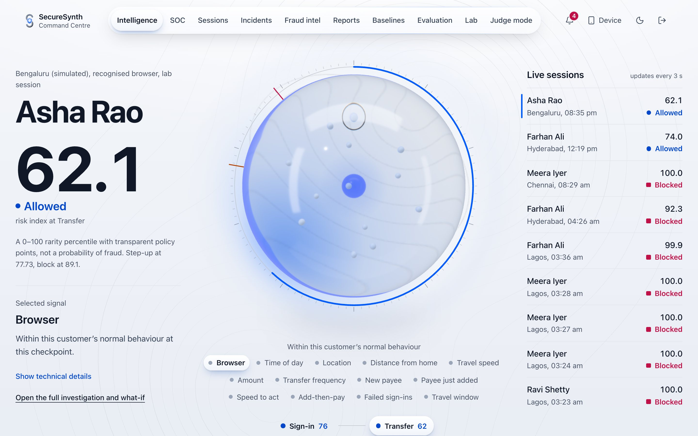
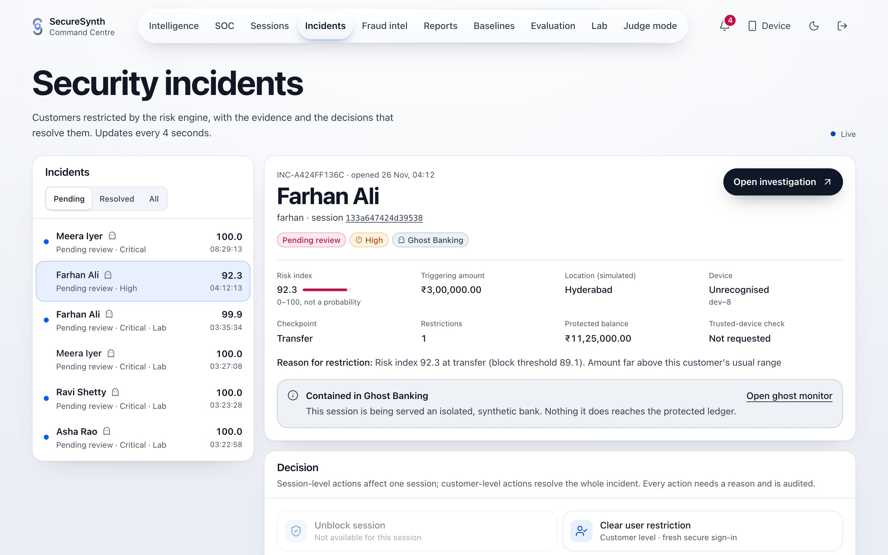
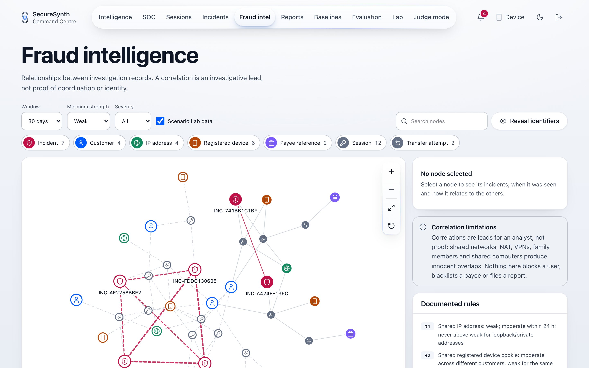
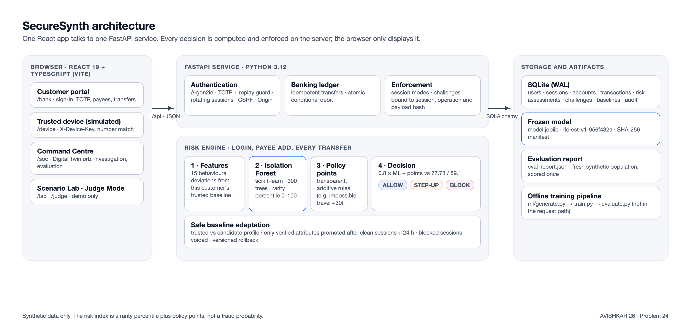
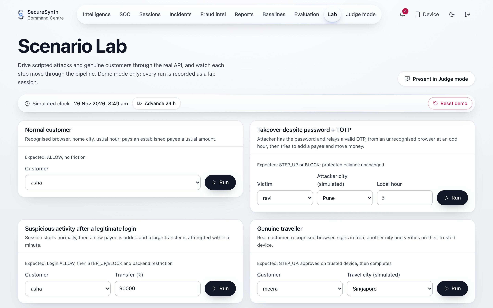
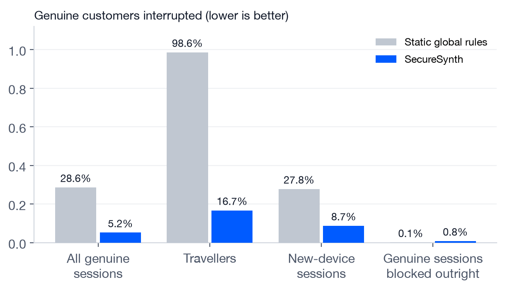
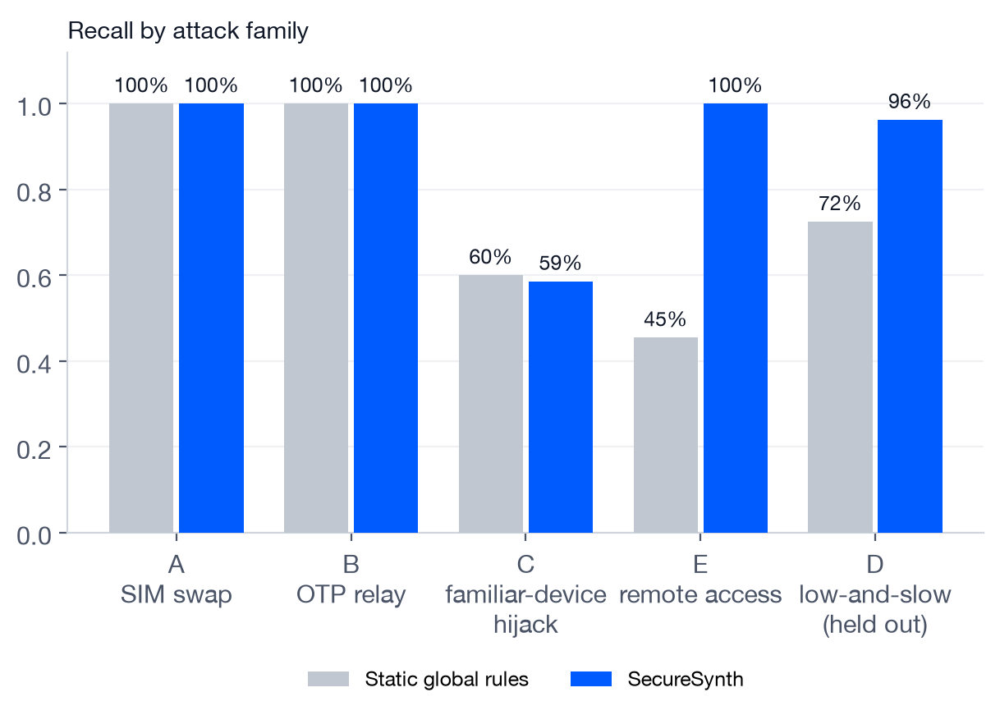

# SecureSynth: risk-based authentication and account takeover detection

Technical report for AVISHKAR'26, problem statement 24 (AI in Cyber Security and FinTech).

| | |
|---|---|
| Team | The_Terminators, team ID AV26-50F33FD4DE |
| Members | Mohammed Hussain, Ayman Ahmed, Samruddh HS, Syed Nihal Mudassir |
| Repository | https://github.com/mdhussain398/SecureSynth (branch `feat/frontend-renaissance`) |
| Model | Isolation Forest `iforest-v1-956f432a`, frozen; evaluation protocol v2 |
| Version | SecureSynth 3.0 |
| Date | 26 November 2026 |

> SecureSynth is a working prototype that runs on synthetic data. We wrote every customer, account, device, location and attack ourselves. The results show the method working on that data; they are not evidence of how it would perform in a real bank. The risk index is a rarity percentile plus written policy points. It is not a fraud probability.



## 1. Summary

Phishing kits relay one-time codes in real time and SIM swaps redirect SMS codes, so attackers now get past the password and the OTP routinely. Once they're in, the bank sees a session that looks properly authenticated. Static rules ("new device, so challenge") catch some of these attacks, but they also challenge almost every customer who travels or changes phone.

SecureSynth treats authentication as a decision that keeps being made for the whole session. At sign-in, when a payee is added and on every transfer, it compares what is happening with this particular customer's trusted behaviour. A shared Isolation Forest scores the deviations, a short list of written policy rules adds points, and the backend enforces the result: ALLOW, STEP-UP or BLOCK. A step-up goes to a separately enrolled trusted device with number matching. The baseline only learns behaviour the customer has verified, so an attacker can't teach it that they belong.

Version 3.0 adds what happens after a block. A blocked session can be contained in an isolated synthetic bank (Ghost Banking, off by default). Evidence is collected into an encrypted, hash-chained vault. Analysts work the case in an incident queue, an investigation workspace and a correlation graph, can prepare a cybercrime complaint, and can restore a genuine customer through a fresh verified sign-in.

We froze the model and scored a fresh synthetic population once: 4,665 sessions, 367 of them takeovers. Against static global rules:

| | Static rules | SecureSynth |
|---|---|---|
| Takeovers flagged (recall) | 76.6% | **91.3%** |
| Genuine sessions interrupted | 28.6% | **5.2%** |
| Precision | 18.6% | 60.1% |
| F1 | 29.9% | 72.5% |

Two results go the other way. SecureSynth doesn't prevent more money overall: static rules stop slightly more attack value (₹2.98 cr against ₹2.96 cr, out of ₹3.10 cr attempted) because they challenge almost everyone. And our weakest case is a hijack on the customer's own familiar device, where recall drops to 58.6%.

## 2. The problem

### 2.1 Why a password and an OTP aren't enough

A phishing kit can forward the one-time code to the real site while the customer is still typing it. A SIM swap sends the SMS code to the attacker's phone. Session hijacking skips sign-in altogether and takes over a session the customer opened legitimately. In all three cases the bank sees correct credentials. In our evaluation, password plus TOTP on its own stepped in on 0 of 367 takeovers and let the full ₹3.10 cr of attempted attack transfers go through.

### 2.2 Why static rules aren't the answer either

Global rules hold every customer to the same yardstick. On the same population they caught 76.6% of takeovers, but they also interrupted 28.6% of all genuine sessions, 98.6% of genuine travellers and 27.8% of genuine new-device sessions. Their precision was 18.6%, so roughly four out of five interventions landed on a genuine customer.

### 2.3 Who cares

| Stakeholder | What they need |
|---|---|
| Customers | Not to lose money to a takeover, and not to be locked out when they travel or get a new phone |
| Fraud and security analysts | Decisions they can explain, investigate and overturn |
| The bank | Less fraud loss and less friction, with an audit trail behind both |

### 2.4 Success criteria

We wrote these down before seeing results (see `docs/evaluation/EVALUATION_PROTOCOL.md`): higher takeover recall than static rules; far fewer genuine customers interrupted; validation targets of at most 5% intervention false-positive rate and at most 0.5% block false-positive rate; every decision explainable and enforced on the server; and a model frozen before a single scoring of a fresh test population.

## 3. How it works

### 3.1 The decision loop

1. **Authenticate.** Password hashed with Argon2id, then a real TOTP code with replay protection. The session token rotates after the TOTP step.
2. **Assess.** At login, payee creation and every transfer, the backend computes 15 behavioural deviations against the customer's trusted baseline, scores them with the Isolation Forest and adds policy points.
3. **Decide and enforce.** `score = clip(0.8 × ML index + sum of policy points, 0, 100)`. BLOCK at 89.1 or above, or on the hard rule of impossible travel plus an unrecognised browser plus a sensitive action. STEP-UP at 77.73 or above. Anything lower is allowed. The backend switches the session into the matching mode, and a restricted session can't read or move money.
4. **Verify and adapt.** A step-up goes to the trusted device. The challenge works once, lasts 120 seconds and is bound to the session, the operation and a SHA-256 hash of the payload. Only verified behaviour can become part of the baseline.

### 3.2 Personal behaviour, one shared model

The features describe how far an action is from this customer's normal, not absolute values. A sign-in at 2 a.m. is ordinary for a night-shift worker and strange for someone who works nine to five. Because each feature is already personal, one shared model can serve every customer.

The 15 features in `backend/app/risk/features.py` are: recognised browser, hour rarity, familiar city, distance from home, implied travel speed, amount against usual (robust z-score), transfer frequency against usual, new payee, minutes since the payee was added, time from sign-in to action, the add-payee-then-pay sequence, failed sign-ins in the last 24 hours, a transfer flag, a payee-add flag and the verified travel window.

### 3.3 Why an Isolation Forest

At the start of a deployment there are hardly any labelled takeovers, and the ones that exist change constantly. An unsupervised rarity model learns what genuine variation looks like and flags whatever falls outside it. We use 300 trees with 512 samples each, and convert the raw score into a percentile (0 to 100) against genuine validation events. Labels are used only for evaluation, and a test checks that the inference code never reads them.

### 3.4 Policy points

| Rule | Points |
|---|---|
| Unrecognised browser | +12 |
| Unfamiliar location | +8 |
| Impossible travel | +30 |
| Payee added less than 10 minutes before the transfer | +20 |
| Amount far above usual | +15 |
| Two or more failed sign-ins | +8 |
| Inside a verified travel window | −15 |

### 3.5 Learning without being poisoned

If an attacker could get their own behaviour into the baseline, they would become "normal". So SecureSynth keeps two profiles per customer: a trusted one used for scoring and a candidate one that collects new behaviour. Only the attribute the customer verified on the trusted device can move from candidate to trusted, and only after two clean sessions and 24 hours. Verified travel becomes a 7-day window rather than permanent trust. Blocked or denied sessions lose everything they contributed, and every change is versioned so an analyst can roll it back.

### 3.6 Explaining decisions

Analysts see four separate panels: the ML index, the observed deviations from the baseline, the exact policy points, and the decision formula with its thresholds. They can also ask a counterfactual question ("what if this one feature had been normal?"), which re-runs the real scoring path, is labelled as hypothetical and is never stored. Customers only ever see short, calm messages. A test makes sure no score or feature name reaches them.

## 4. After a block: SecureSynth 3.0

The original prototype stopped at BLOCK. In practice that's where an analyst's work starts, so 3.0 follows the incident through containment, evidence, investigation, reporting and recovery.

### 4.1 Containment and Ghost Banking

A blocked session is normally restricted. With Ghost Banking enabled, it's moved into an isolated synthetic bank instead: the attacker can keep browsing, add payees and "send" money, and all of it happens on a separate ledger in its own database. The ghost code never imports the protected tables (a test scans the source to check), and startup refuses to run if the two databases would share a file. Turning Ghost Banking off restricts every live ghost session; none of them is ever moved back into protected banking.

Ghost Banking deliberately deceives the person holding the session, which the competition rule book (§12) treats with caution. It is therefore off by default and gated twice: a deployment flag plus a mentor approval reference, then a runtime switch on the SOC dashboard that needs a reason, a fresh TOTP code and the current version number, with every change kept in a history.

### 4.2 The evidence vault

Every restriction collects the server-observed IP address and its scope, the registered device record, the parsed browser and operating system (for display only), the risk assessment and the transfer attempt. Analyst decisions, verification outcomes, notes and consented photographs are added as they happen. Each item is labelled observed, derived or synthetic.

Files are encrypted with Fernet. Each ledger entry stores a SHA-256 hash of the item and of the previous entry, on two separate chains for genuine and Lab data. Verification detects modified content, missing files and broken links, raises an alert and marks the incident unread. It never repairs anything. This makes the vault tamper-evident, not immutable: someone who controls the whole store could rewrite the data and its hashes together, and stronger guarantees would need checkpoints anchored outside the system.

We don't collect MAC addresses (browsers don't expose them) and we don't fingerprint devices. A photograph is only taken with the customer's explicit consent in their own browser, and it is never used for facial recognition or treated as proof of identity.



### 4.3 Investigation

Analysts get an incident queue with the decisions they can take (unblock one session, clear the customer, request trusted-device verification, keep restricted, revoke), and a workspace per incident with overview, evidence, timeline, summary and report tabs. Every action needs a reason and is written to the audit log.

The fraud intelligence graph links incidents that share an IP address (weak, or moderate within 24 hours), a registered device cookie or a payee reference (moderate across different customers). Two or more independent links count as strong. Each link comes with its explanation and provenance. The graph presents leads: nothing in it blocks a user, blacklists a payee or files a report on its own.



An investigation summary is generated deterministically from the evidence. Each section is marked as fact, interpretation or recommendation and cites the evidence it rests on. It goes stale when the evidence changes, and approval needs a fresh one. An optional language-model rewrite exists behind several explicit switches, with identifiers redacted from its input; it's off unless configured.

### 4.4 Reporting and recovery

An analyst can prepare a cybercrime complaint in five stages: draft, review, a checklist confirmation, a final confirmation with a reason, a fresh TOTP and a typed phrase, and then submission. By default the destination is a local demo service, and every screen and file says no real complaint will be filed. The official route to the National Cyber Crime Reporting Portal is a guided hand-off: there's no public submission API, so the authorised person files on the portal themselves and the analyst records the acknowledgement afterwards.

A genuine customer who was restricted is restored by an analyst decision, never automatically, and always through a fresh, verified sign-in.

## 5. Architecture



The protected bank, Ghost Banking, the evidence vault and the demo complaint service each have their own SQLite database, and the backend refuses to start if any two share a file.

| Technology | Why we used it |
|---|---|
| React 19 and TypeScript (Vite) | A typed API contract shared with the backend, and fast offline builds |
| Tailwind CSS v4, Motion, three.js with React Three Fiber | One design system across every screen, motion that respects reduced-motion settings, and a lazy-loaded 3D orb with a CSS fallback |
| FastAPI (Python 3.12) and Pydantic 2 | Validation and authorisation on every route, with OpenAPI generated from the code |
| SQLAlchemy 2 and SQLite (WAL) | No setup, works offline, transactional. A transfer is one atomic conditional debit with an idempotency key |
| argon2-cffi, PyOTP, cryptography (Fernet) | Argon2id passwords, RFC 6238 TOTP with replay protection, encrypted TOTP seeds and evidence files |
| scikit-learn Isolation Forest | Needs no takeover labels, trains in seconds and scores in milliseconds |
| pytest | 165 backend tests covering security, the ledger, challenges, baselines, the engine, Ghost Banking, incidents, investigation, the Lab and ML hygiene |

Once installed, everything runs offline. There's no Docker, no external API and no paid service, and the product calls no AI service at runtime unless someone explicitly configures the optional summary rewrite.

## 6. Implementation

### 6.1 One transfer, end to end

1. The browser sends `POST /api/bank/transfers` with the session cookie, an `X-CSRF-Token` header and an idempotency key.
2. The backend checks the session mode, CSRF token, Origin and that the payee belongs to this customer.
3. The risk engine builds features from history before the event, scores them and applies policy. It stores the whole assessment: features, deviations, ML index, points, decision, thresholds and latency.
4. On ALLOW the debit runs atomically. On STEP-UP the response is 202 with a challenge; the trusted device shows the number to match, and on approval the bound payload runs. On BLOCK the session is restricted (or contained in Ghost Banking), an incident opens and evidence is collected.
5. Each step goes to the audit log, which keeps an allow-list of fields and never stores secrets.

### 6.2 Controls the tests enforce

| Control | Test (`backend/tests`) |
|---|---|
| A correct password and OTP from the wrong person is still assessed | `test_continuous_risk_*` |
| Account data stays unreadable until a login step-up is approved | `test_unverified_login_step_up_cannot_read_account_data` |
| A replayed TOTP code is rejected | `test_totp_replay_rejected` |
| Another user's device can't approve a challenge | `test_other_users_device_cannot_approve` |
| Mutations without CSRF or from a foreign origin are rejected | `test_totp_without_csrf_header_rejected`, `test_foreign_origin_rejected_on_mutation` |
| No score or feature name reaches a customer | `test_customer_message_reveals_no_scores_or_feature_names` |

### 6.3 Scenario Lab

The Lab drives 11 scripted scenarios through the real API, with simulated time that applies only to its own requests and data kept separate from genuine incidents. The first six were verified live:

| # | Scenario | Expected | What happened |
|---|---|---|---|
| 1 | Normal customer | ALLOW | Allowed; asha pays ₹2,500 |
| 2 | Takeover despite password and TOTP | STEP-UP or BLOCK, balance unchanged | Blocked and restricted; ravi's ₹96,200 untouched |
| 3 | Suspicious activity after a genuine login | Login allowed, then an intervention | Step-up, then restriction; balance unchanged |
| 4 | Genuine traveller | STEP-UP, approved, completes | Approved on the trusted device; ₹2,500 goes through |
| 5 | Customer on a new device | STEP-UP, approved | Approved; the transfer completes |
| 6 | Unusual but genuine transfer | Friction grows with the amount | Allowed at the ₹1,50,000 default |

Scenarios 7 to 11 cover Ghost Banking containment, escalation through evidence and reporting, a correlated fraud ring, evidence tamper detection and the live SOC.



## 7. Results

### 7.1 Method

We wrote the protocol down before any v2 result was visible (`docs/evaluation/EVALUATION_PROTOCOL.md`). Development data used seed 2026, with days 0 to 60 for training and days 60 to 75 for validation; thresholds and the ML weight were chosen on validation data only. We then froze the model and every scoring file with SHA-256 hashes, generated a new population (seed 9091, 240 customers) and scored its days 75 to 90 once: 4,665 sessions and 367 takeovers across five attack families, one of which (family D) was kept out of validation. All three approaches ran on the same sessions with the same outcome function, and a "positive" means any intervention, STEP-UP or BLOCK.

### 7.2 Detection


| Approach | TP | FP | FN | TN | Precision | Recall | F1 | Genuine sessions interrupted |
|---|---|---|---|---|---|---|---|---|
| Password + TOTP | 0 | 0 | 367 | 4,298 | 0.0% | 0.0% | 0.0% | 0.0% |
| Static global rules | 281 | 1,230 | 86 | 3,068 | 18.6% | 76.6% | 29.9% | 28.6% |
| **SecureSynth** | **335** | **222** | **32** | **4,076** | **60.1%** | **91.3%** | **72.5%** | **5.2%** |

Counting blocks only:

| Approach | Precision | Recall | Block false-positive rate |
|---|---|---|---|
| Static global rules | 98.2% | 43.3% | 0.07% |
| SecureSynth | 86.6% | 61.9% | 0.81% |

### 7.3 Friction for genuine customers



| Who was interrupted | Static rules | SecureSynth |
|---|---|---|
| Travellers | 98.6% | 16.7% |
| New-device sessions | 27.8% | 8.7% |
| Genuine sessions blocked outright | 0.07% | 0.81% |

### 7.4 By attack family



SecureSynth caught every takeover in the SIM swap (A), OTP relay (B) and remote access (E) families, and 96.3% of the held-out low-and-slow family (D). On familiar-device hijack (C) it caught 58.6%, slightly below static rules at 60.0%.

### 7.5 Money (simulated)


| Approach | Attempted | Prevented | Lost | Genuine value delayed |
|---|---|---|---|---|
| Password + TOTP | ₹3.10 cr | ₹0 | ₹3.10 cr | ₹0 |
| Static global rules | ₹3.10 cr | ₹2.98 cr | ₹12.2 lakh | ₹2.89 cr |
| SecureSynth | ₹3.10 cr | ₹2.96 cr | ₹14.6 lakh | ₹57.0 lakh |

A BLOCK stops money for good. Money stopped by a step-up only counts as prevented if the attacker can't pass trusted-device verification.

| Approach | Stopped by BLOCK | Stopped by step-up |
|---|---|---|
| SecureSynth | ₹2.61 cr | ₹34.8 lakh |
| Static global rules | ₹2.38 cr | ₹59.9 lakh |

SecureSynth also blocks more genuine money outright: ₹25.0 lakh against ₹0.3 lakh.

### 7.6 Engineering checks

| Check | Result |
|---|---|
| Decision latency (in process, one laptop, no network or database time) | p50 5.48 ms, p95 5.61 ms |
| Backend tests | `make test`: 165 passed |
| Frontend | `tsc -b` and `npm run build` pass |
| Frozen manifest | all 6 SHA-256 hashes match |
| Fraud intel graph (production build, headless Chrome) | load, zoom, pan and node drag hold 60 fps with no long tasks |

### 7.7 How to read these numbers

The main gain is less friction, not more money saved. SecureSynth catches more takeovers while interrupting about a fifth as many genuine sessions and delaying about a fifth as much genuine money. It prevents slightly less money in total than static rules, stops more attack money outright and also blocks more genuine money outright. The block false-positive rate drifted from the 0.5% validation target to 0.81% on the fresh population.

We also withdrew an earlier protocol (v1). It reported 100% recall because its synthetic attacks were too easy to tell apart, and its numbers are marked as superseded.

## 8. Limitations

- Everything is synthetic and nothing has been validated on real data. Real attackers behave in more varied ways than the ones we wrote.
- Familiar-device hijack (family C, 58.6%) needs signals a personal baseline doesn't have, such as payee risk and transaction intent.
- Location comes from a synthetic IP-to-city table, the trusted device is a web page with its own credential, and device recognition is a cookie: a signal, not an identity.
- The evidence vault is tamper-evident, not immutable, and nothing here establishes legal admissibility.
- Infrastructure is prototype grade: single-node SQLite, in-memory rate limits, development servers without TLS, and incident notifications that poll every 4 seconds rather than push.
- Ghost Banking is implemented and tested but stays off until a mentor approves it.
- We haven't done a demographic fairness audit, which synthetic personas can't support.

The full list is in `docs/evaluation/KNOWN_LIMITATIONS.md`.

## 9. Where this could go

### 9.1 Uses in a bank

Asking for step-up only when behaviour is unusual for this customer, instead of sending OTPs to everyone. Checking continuously after login, at payee creation and on transfers, which is where takeovers actually drain accounts. Giving analysts a console that explains each decision, keeps the evidence and lets them roll back a baseline.

### 9.2 What production would need

1. Validation on real, consented, labelled bank data, with fairness and drift monitoring and recalibrated thresholds.
2. A real trusted-device channel: a push app with keys in the secure enclave and device attestation.
3. Real signals: IP intelligence, device binding, payee and mule-account risk, and transaction intent.
4. Production infrastructure: PostgreSQL, distributed rate limiting, TLS everywhere, keys in a KMS or HSM, and a stateless API and scorer that scale horizontally.
5. Evidence-ledger checkpoints anchored outside the system, retention rules and legal holds.
6. A security review, penetration testing and regulatory alignment.

### 9.3 Takeaway

A correct password and a correct OTP show that someone has the credentials. They don't show that the customer is there. SecureSynth keeps checking after sign-in, explains each decision, asks the real customer when it isn't sure, and gives analysts what they need once something goes wrong. On our synthetic evaluation that caught more takeovers than static rules while interrupting far fewer genuine customers, and we've tried to be clear about where it falls short.

## Appendix A: reproducing the results

```bash
make test
```

```bash
cd frontend && npx tsc -b && npm run build
```

`make eval` reproduces the evaluation, but only while the frozen files are unchanged. `docs/report/tools/charts.py` redraws every chart in this report from `backend/artifacts/eval_report.json`.

## Appendix B: AI assistance

We used Claude Code (Anthropic) to help write code, tests and documentation, which the organisers confirmed was allowed. The design decisions, the review and the demonstration are the team's own. The product doesn't call any AI service unless the optional summary rewrite is explicitly configured.
